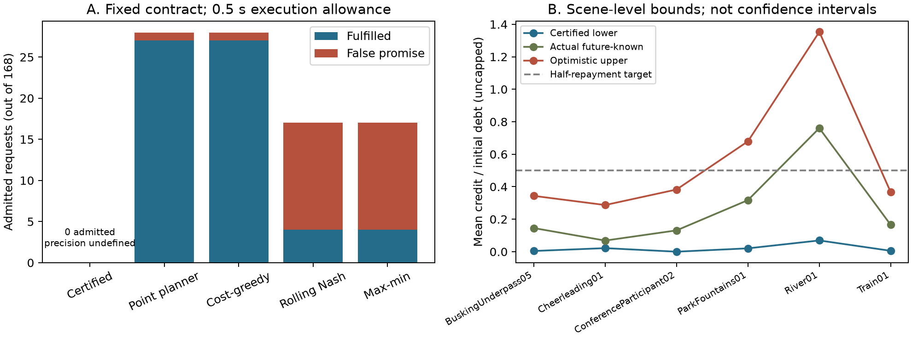

# Feasibility-based recovery admission

The [fixed protocol](PLAN.md) retains the distortion/deadline contract and
distinguishes conditional admission, certified impossibility and abstention.
The [derivation](THEORY.md) uses sender-side spatial bounds without future user
quality. Causal point-planning controls are evaluated under the same contract;
future-known paths are offline diagnostics, not admission inputs.

```console
python -m unittest admission_contract.test_core -v
python -m admission_contract.run
python -m admission_contract.run --verify
python -m admission_contract.diagnose --verify
python -m unittest admission_contract.test_validation -v
```

The batch uses only already exposed public scalar labels, sender error maps,
file-byte metadata, media timelines and prior timing records. No private pose
cache, media download or GPU is needed. Commands refuse to overwrite results.
All code and outcomes are published before any manuscript or fresh holdout work.
Passing software tests alone does not establish useful or deployable admission.

## Completed exposed findings

The conservative planner certifies112 episodes as impossible, abstains on56 and
admits0. Precision with no admissions is undefined. The point planner and simple
cost-greedy each admit28, fulfill27 in replay and make1 false promise; all28 are
River01 and their executed paths agree on every episode. Rolling Nash/max-min
each admit17 and fulfill4 under the exact both-user floors. No probabilistic or
unconditional deployment guarantee follows.

See the [complete report](results/exposed_v1/REPORT.md),
[interpretation and failure analysis](INTERPRETATION.md), and
[verification record](VERIFICATION.md). Both-OS full replay and independent
certificate/ledger checks pass; these implementation checks do not establish
useful certified positive admission.



Panel A is deterministic replay of entry-time plans, not new measured playback.
Panel B contains scene means of distinct bounds, not confidence intervals. The
optimistic upper allows all four segments and ignores quality floors.
