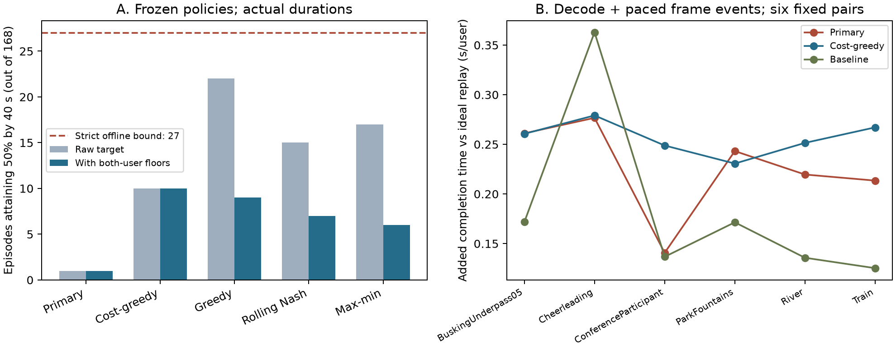

# Engineering distortion/deadline contract and actual-duration playback

The [fixed protocol](PLAN.md) defines completed-segment sampled distortion-seconds
by40s, with strict native quality floors and separate timing diagnostics. It
does not choose the previously favorable PSNR account or claim human QoE.
Actions, initial event and resource allowances remain fixed; old files are not
modified. No new holdout or controller training is involved.

The new timing stage measures software decoding, frame hashing and monotonic
PTS pacing with scripted arrivals. Pixels are not rendered. This is not a
physical player/HMD experiment or a new network measurement.

## Reproduction

Public scalar evidence, no private media needed:

```console
python -m unittest duration_contract.test_core -v
python -m duration_contract.run --verify
python -m duration_contract.audit --verify
python -m duration_contract.diagnose --verify
python -m unittest duration_contract.test_validation -v
```

Full local preparation and real-time measurement need the original, hash-matched
exposed MP4 cache, FFmpeg/ffprobe and the existing Python/NumPy environment:

```console
python -m duration_contract.prepare
python -m duration_contract.run
python -m duration_contract.paced
python -m duration_contract.audit
```

Commands refuse to overwrite existing artifacts. The19-session measurement
uses at most2 concurrent sessions and takes several minutes; do not run other
compute-intensive work during timing. Metadata records the exact method, media
hashes, platform and session order. Failed/partial sessions are retained.

## Completed findings

- All216 existing MP4 identities and packet timelines pass. Only the six final
  River01 representations are1/30s shorter than the nominal10s.
- Full168-episode replay produces3,024 policy/duration rows,2,688 exact historical
  score checks and336 independently verified future-known bounds. Actual duration
  changes no recovery-credit or target outcome. Protected half-repayment by40s:
  primary1/168; cost-greedy10/168; strict future-known bound27/168.
- All19 real-time sessions pass the independent45,594-frame/152-segment audit.
  The late-arrival control earns zero deadline credit. None of the six nominal
  fixed pairs reaches half-repayment for either primary or cost-greedy; these
  pairs are only a subset of the full exposed population.
- Measured timing adds mean0.226/0.256/0.184s per user relative to ideal playback
  for primary/cost-greedy/baseline. Four of18 nominal sessions lose some deadline
  credit; no half-repayment classification changes. No deadline was relaxed.
- Independent byte ledgers pass all3,024 paths; repeated decoding matches all109
  repeated streams, spanning43 distinct encoded files. This checks consistency,
  not perceptual correctness. No controller or metric was retuned after outcomes.

Read the [interpretation](INTERPRETATION.md), [replay report](results/replay_v1/REPORT.md),
[timing report](results/measured_audit_v1/REPORT.md), and
[execution notes](EXECUTION_NOTES.md). Passing implementation checks is not
evidence of successful compensation or a deployment guarantee.



Panel A uses all168 exposed directed episodes; Panel B uses six fixed pairs.
The dashed bound is future-known and subject to strict quality floors. The
timing panel measures decode/hash and event pacing, not physical display or
network transfer. All raw scalar records, including the negative control, are
in `results/paced_v1/`; encoded videos and pose telemetry are not redistributed.
