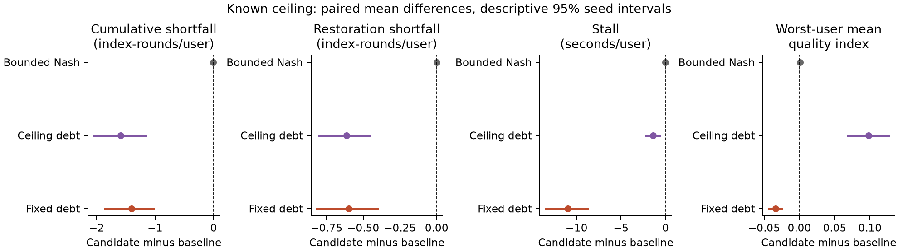
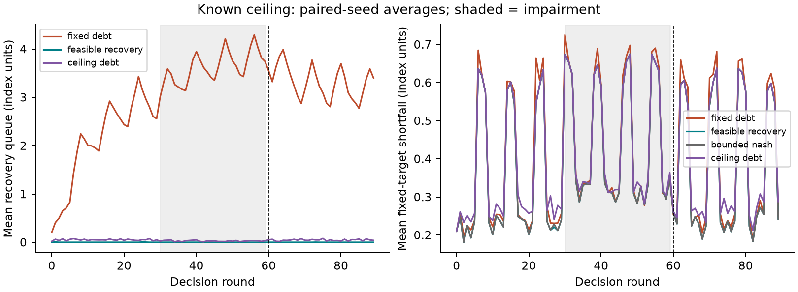

# Fresh-content pilot v2: findings and decision

**The predeclared progression screen failed.** The new reference reduces queue
windup and improves several aggregate outcomes relative to fixed-target debt,
but it sacrifices more worst-user quality than the declared tolerance. More
decisively for the mechanism claim, it is almost action-identical to bounded
Nash and exactly action-identical to its memoryless ablation in this campaign.
These results do not establish an added benefit from persistent recovery memory.

No parameters were retuned after examining this holdout. The previous failed
v1 is retained; neither study is overwritten or relabelled a successful trial.

## Design and integrity

- Protocol/core commit `0bbdaa3` predates fresh source downloads; campaign
  implementation `2d8a72d` predates held-out evaluation. Runtime head `b4b2abe`.
- New scenes: ParkFountains01, River01, Train01. Their measured representations
  and HMD sequences were not in prior experiments. This is a content/sequence
  holdout within the same dataset/participant pool, not new participants.
- Nine calibration panels, nineteen held-out panels; no test-label fitting.
  Full-sphere sender predictor, same objective target as evaluation. Radius
  0.877073 index units; empirical complete-panel coverage 18/19 (94.7%).
  This small empirical fraction is not a conditional or shift-validity claim.
- RTX 3090 used for six H.264 encodes per scene. Analysis follows the frozen
  1920x960 encode /960x480 1-fps metric protocol, not 8K delivery validation.
- 20 paired seeds, four scenarios, six policies, five clients, 90 rounds:
  **216,000 user-round records**, 480 episodes and 43,200 joint decisions.
- Exact small-system optimization; all elapsed fluid-playback time accounted
  for. Runtime measured separately, not injected into simulated playback.
- Full replay audits verify scientific rows, allocations, feasibility witnesses,
  clock conservation, input/source/result hashes and all reported comparisons.
  Recorded maximum clock residual is 1.42e-14 seconds. Integrity is distinct
  from efficacy: a passed audit does not change the failed performance screen.

## Main comparison: known ceiling, candidate minus fixed debt

All quality shortfalls retain the external target **four**, irrespective of
the controller's internal feasible reference. Intervals below are descriptive
paired-seed bootstrap intervals conditional on this three-scene catalogue.

| Outcome | Fixed debt | Feasible recovery | Difference [95% interval] |
|---|---:|---:|---|
| Cumulative shortfall, index-rounds/user | 36.0309 | 34.6303 | -1.4006 [-1.8586, -1.0325] |
| Post-restoration shortfall, index-rounds/user | 11.8303 | 11.2303 | -0.6000 [-0.8150, -0.4043] |
| Stall seconds/user | 36.0101 | 25.0359 | -10.9743 [-13.4472, -8.7286] |
| Worst-user mean quality index | 3.17960 | 3.14585 | **-0.03375 [-0.04317, -0.02483]** |
| Mean quality index | 3.74122 | 3.75834 | +0.01712 [0.01199, 0.02304] |

That is about 3.9% less cumulative shortfall and 30.5% less stall, but the
worst-user decline exceeds the predeclared maximum of 0.02 index units. The
other three scenarios also trade reduced shortfall/stall for lower worst-user
quality. The aggregate improvement cannot be presented as universal fairness.

The impaired user's own post-restoration shortfall difference is -0.0468 with
interval [-0.8943, 0.8294], not evidence of better individual recovery. Two-round
quality recovery is observed in only 12/20 main-condition episodes for both
policies; the other eight are right-censored at 30 rounds. Capped waiting times
must not be described as recovery having occurred in every episode.

The same candidate is compared against fixed debt, ceiling-only debt and bounded
Nash. Zero denotes no difference. The near-zero Nash contrasts are crucial to
interpreting the apparent gains against fixed debt.

## Why this does not validate a distinct recovery mechanism

In the main condition:

- The candidate's queue is zero before **99.933%** of user decisions.
- Its internal feasible reference averages **2.6935**, versus external target 4.
- It differs from bounded Nash in just **4 of 9,000** user actions: 99.956%
  agreement. Its cumulative-shortfall difference versus Nash is only -0.00755
  index-rounds/user; post-restoration shortfall is exactly tied.
- It is **exactly action-identical to memoryless feasible debt**. This equality
  holds across all four scenarios: no added persistent-memory benefit is shown.
- Across all scenarios, only 20/36,000 candidate user actions differ from Nash.

The evidence is consistent with a reference that is too conservative to activate
meaningful recovery in this operating range. This is a diagnosis from queue
activity and action agreement, not a causal attribution to calibration alone:
an uncalibrated-reference ablation was not part of this fixed campaign.

Against ceiling-only debt, worst-user quality improves by 0.09818 but mean
quality falls by 0.00518; that result still does not establish an advantage over
the simpler Nash policy. No single favorable comparator should be isolated.

The queue is almost inactive even while fixed-target shortfall persists. The
right panel shows why internal queue reduction and delivered-quality recovery
are different outcomes. Non-queue baselines' diagnostic shadow queues are not
plotted as if those baselines used them for decisions.

## Heterogeneity and limitations

Known-ceiling mean-quality changes relative to fixed debt, averaged within scene
and then across paired seeds, are -0.00557 for ParkFountains01, -0.02593 for
River01 and +0.07759 for Train01. River01 worsens in every seed; Train01 improves
in every seed. Aggregate gains conceal a content-specific trade-off.

This remains a small, looped-catalogue simulation with synthetic ceilings and
capacity variation. It does not demonstrate subjective QoE, live-player
performance, independent-dataset generalization, a scalable optimizer, or
publication-level novelty. Exact score/byte ties are enumeration-dependent.
The calibrated envelope can be conservative and need not survive injected shift.

## Research consequence

The implementation and negative/mechanistic evidence are useful, but **do not
promote v2 as a validated new recovery contribution**. More seeds of this same
design would not resolve near-equivalence to the no-debt baseline. A defensible
next study would first establish nontrivial temporal recovery on development
data, with achievable longer-horizon entitlements or another explicitly justified
reference, matched no-memory/no-debt controls, and a worst-user guardrail. Such
a redesign requires a separately frozen evaluation on further unused data.
The three v2 scenes are now exposed and cannot be reused as a fresh holdout.

The alternative is a narrower, honestly framed study of the measured
quality/fairness/continuity trade-off. Neither route authorizes claims that the
current experiment does not support. The manuscript has not been changed to
claim a successful recovery result.
