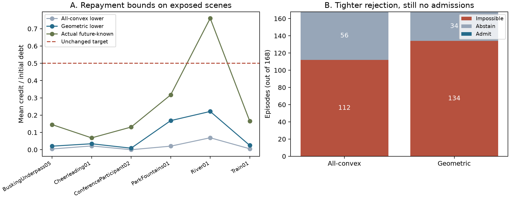

# Geometric viewport admission bounds

This [fixed protocol](PLAN.md) replaces arbitrary convex tile weights with the
complete finite family of masks generated by the existing100°×100° tile-centre
viewport model. It preserves all quality, timing and resource requirements and
the previous point-planning controls. The geometry is exact for this model, not
a physical HMD frustum, lens model or new perceptual metric.

```console
python -m unittest geometric_admission.test_geometry -v
python -m geometric_admission.run
python -m geometric_admission.run --verify
python -m geometric_admission.diagnose --verify
python -m unittest geometric_admission.test_validation -v
```

All inputs are already exposed public scalar data and sender maps. No private
future poses, new downloads or GPU are needed. Commands refuse to overwrite
results. The protocol retains negative results and does not turn zero admissions
into a success claim. Code and results precede any manuscript or holdout work.

## Completed findings

The complete family contains216 masks. Geometric bounds increase certified
impossibility from112 to134 of168 episodes, reduce abstentions from56 to34, and
still admit none. All22 additional rejections are ParkFountains01 cases.
The matched point-only controls and their failures remain unchanged.

A separately labeled post-outcome check upper-bounds the best fixed plan's
worst-case repayment under arbitrary changes among these geometric viewports.
Even without quality floors, all168 bounds remain below50%; the largest is32.16%.
This rules out a universal precommitted promise in this uncertainty class, not
every adaptive controller or recovery on favorable observed trajectories.

See the [primary report](results/exposed_v1/REPORT.md),
[interpretation](INTERPRETATION.md), [derivation](THEORY.md), and
[verification record](VERIFICATION.md).



Panel A reports scene means of deterministic bounds, not confidence intervals.
Panel B shows stronger rejection but no positive admission under the unchanged
contract. These are exposed-model calculations, not new physical playback tests.
