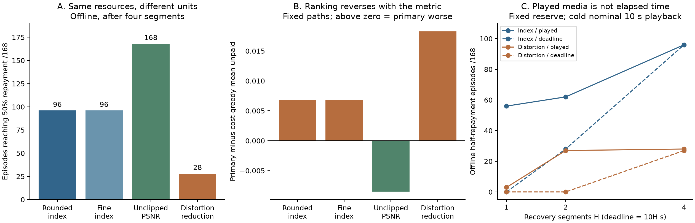

# Metric and service-contract sensitivity

Exploratory audit of **exposed** data; no controller tuning or new holdout.
The [fixed protocol](PLAN.md) separates rescoring eight saved policy paths from
future-known strict-floor opportunity bounds. Four metric mappings, two initial
impairment-rung accounts, four repayment targets, three recovery horizons and
two credit clocks are fixed before the batch. All earlier artifacts are unchanged.

## Reproduce

From the repository root, using Python with NumPy:

```console
python -m unittest metric_contract.test_core -v
python -m metric_contract.run --verify
```

`--verify` reruns the complete grid, independent scalar path enumeration,
minimum-cost witnesses and historical parity checks, then checks source/input
hashes and the published outcome. Without `--verify`, the command creates a
new result directory and refuses to overwrite it. No private telemetry, media,
network transfer or GPU is needed: the inputs are existing published scalar
quality values, actual-file sizes and frozen paths.

## Completed results

The [interpretation](INTERPRETATION.md) and [complete grid report](results/sensitivity_v1/REPORT.md)
show material dependence on the accounting metric. Original-event half-repayment
is feasible offline in 96/168 episodes with the rounded index, 96 with the fine
index, 168 with PSNR and 28 with distortion reduction under the same resources.
The difference persists with common floor admissibility. Fixed-policy rankings
also reverse; no new successful controller or metric-independent claim follows.



The separately labeled post-hoc [diagnostics](results/diagnostics_v1/results.json)
and SVG figure can be verified with:

```console
python -m metric_contract.diagnose --verify
python -m unittest metric_contract.test_validation -v
```

All historical data and methods are unchanged. See [execution notes](MEASUREMENT_NOTES.md)
for the reporting-only metadata failure and its correction. Neither the bound
nor the counterfactual rescoring is a deployable new recovery controller.
