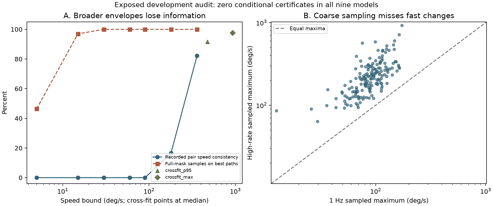

# Exposed temporal viewport-model audit

Investigate whether a spherical motion envelope both covers the existing
high-rate traces and meaningfully tightens the fixed-contract recovery bounds.
No new controller, holdout, media, human study or physical experiment is added.
See the frozen [plan](PLAN.md) and [geometry/model boundaries](THEORY.md).

The completed audit finds **zero conditional half-repayment certificates** in
all nine models under both ideal and 0.5-second execution allowances. The two
fitted models satisfy the sampled source-speed check for 154/168 and 164/168
episode pairs, respectively, yet permit all 216 masks before the assumed
entry decision. Their apparent coverage is not a future-motion guarantee.
See the [interpretation](INTERPRETATION.md), [complete primary report](results/exposed_v1/REPORT.md)
and [verification record](VERIFICATION.md).



```console
python -m unittest temporal_viewport.test_core temporal_viewport.test_validation -v
# Requires the already acquired source archives and local causal event cache:
python -m temporal_viewport.prepare
python -m temporal_viewport.prepare --verify
# Public scalar-feature replay (no private traces required):
python -m temporal_viewport.run
python -m temporal_viewport.run --verify
# Separately labeled post-outcome diagnostics and saved-figure integrity:
python -m temporal_viewport.diagnose --verify
```

Both generators refuse to overwrite saved data/results. Raw poses and entry
anchors are not published. The public release contains derived speed statistics
and timing-conditioned quality lower bounds sufficient to reproduce the finite
optimization. Full source derivation requires the existing licensed originals.

An empirical maximum is not a hard future-motion limit. A conditional
certificate is not a validated deployment promise, and failure of the
independent-cone certificate does not prove coupled/adaptive impossibility.
